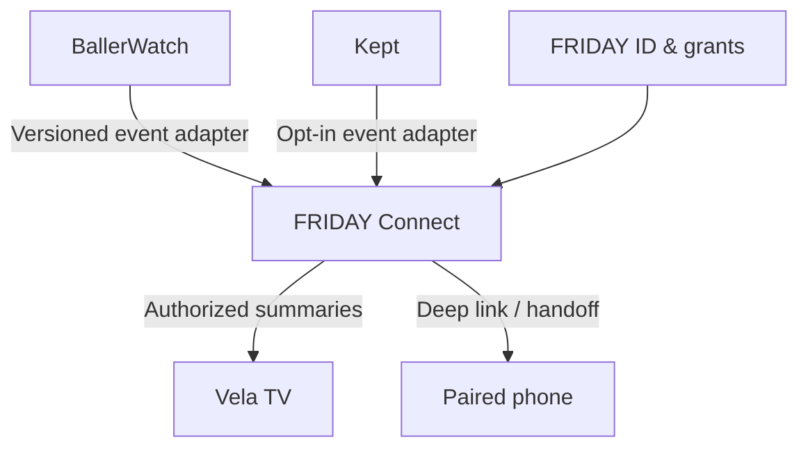

# FRIDAY Architecture (proposal)

**Stage:** design and integration planning. **Current state:** three independent application repos. FRIDAY services are not assumed deployed.

## Ownership and dependencies

| System | Owns | May share with FRIDAY (after consent and authorization) | Must not require FRIDAY for |
| --- | --- | --- | --- |
| BallerWatch | Sports schedules, match data, scouting, personal match settings | Sanitized game/event summaries, deep links, notification signals | Match tracking, existing ICS/calendar, current notifications |
| Kept | Appliances, maintenance schedules, shopping and completion state | Due/overdue reminders, task deep links, authorized completion actions later | Local/offline maintenance and shopping |
| Vela TV | TV launcher, TV profiles, focus/navigation, local display preferences | Authorized calendar display, device pairing, remote-control state | Launcher operation and last-good local display |
| FRIDAY (future) | Association of identities/households/devices, grants, integration routing, derived event views | Minimal metadata to consumers under appropriate scopes | Never a new canonical store for the other apps' domain records |

## Proposed topology



This drawing is a **target**, not a deployed topology. During the first stage, Vela retains direct Google Calendar/BallerWatch ICS support; a FRIDAY adapter must be optional.

## Recommended integration rollout

1. **Read-only event contracts:** normalized sports and maintenance projections with stable IDs, start/end/time zone, current status, visibility and source links.
2. **Vela consumer:** display *Now*, *Next*, then near-future events with concise summaries; details only on selection. Respect TV profile permissions.
3. **Identity and consent:** evaluate existing logins first; use standards-based identity and narrow grants rather than implementing a homemade shared password service.
4. **Device pairing and handoff:** pair TV and phone through expiring, revocable credentials; implement one-controller-at-a-time remote control on a secured channel where feasible.
5. **Unified notification rules:** source deduplication and user/device opt-in; preserve current notification paths until proven equivalent.

## Versioned event payload (illustrative)

```json
{
  "schemaVersion": 1,
  "id": "ballerwatch:game:example-123",
  "source": "ballerwatch",
  "category": "playing",
  "title": "Soccer game",
  "startAt": "2026-10-29T20:00:00-07:00",
  "endAt": "2026-10-29T22:00:00-07:00",
  "timeZone": "America/Los_Angeles",
  "status": "confirmed",
  "visibility": "authorized-profile",
  "detailsRef": "ballerwatch:game:example-123",
  "updatedAt": "2026-10-25T09:00:00Z"
}
```

The example is **not** a production contract. Define schema validation, tombstones, stale-data policy, event time changes, and profile-scoped filtering before implementation. Real records must not be copied into public fixtures.

## Free-first infrastructure

- Preserve existing GitHub Pages, Actions, encrypted state branches and Cloudflare Worker paths in the owning repos.
- Consider a small Cloudflare Worker API plus D1 for *minimal* FRIDAY relationship/grant and rebuildable event metadata; avoid duplicating primary app databases.
- Evaluate managed OIDC/OAuth with PKCE and device-pairing standards against existing auth before choosing an identity provider.
- Check current platform quotas and third-party terms before implementation; keep rate limiting, caching, request cost, and offline fallback explicit.

## Reliability and security checks

- FRIDAY unavailable: each app remains functional; Vela uses cached items/current ICS subscriptions.
- Producer unavailable: use last-known-good data with a bounded staleness indicator; no invented updates.
- Revoked sharing: immediately remove access and cached private projections within the defined revocation window.
- Duplicate updates/retries: no repeat notifications or repeated state mutation.
- Time zones/DST: preserve canonical event instants plus source zone; test clocks around transition dates.
- Version skew: old consumers ignore optional unknown fields and fail closed for incompatible security semantics.
